# Inkling-2-Mini Prefill Performance Investigation & Optimization Plan

> [!NOTE]
> **Status:** Implemented and verified. See [inkling2-mini.md](inkling2-mini.md) for the verified Phase 2 `ninfer_bench` and `ninfer-perplexity` results (`1,693–1,922 tok/s` prefill on RTX 4060 Ti 16 GB, `19.2×–28.6×` speedup over Phase 1).

## 1. Goal & Executive Summary

The newly ported `inkling2-mini / q3g128` target (`src/targets/inkling2_mini/`) achieves full numerical and functional qualification on RTX 4060 Ti 16 GB (`sm_89`), but its Phase 1 baseline prefill throughput is only **59–92 tok/s** (`~11.1–17.3 seconds` per 1024-token prefill chunk):

| Benchmark Case (`ninfer_bench`) | Phase 1 Prefill (tok/s) | Time per 1K Tokens |
|---|---:|---:|
| `pp512` | `92.16` | `10.85 s` |
| `pp2048` | `86.17` | `11.60 s` |
| `pp4096+tg128` | `82.34` | `12.14 s` |
| `pp16384+tg128` | `70.95` | `14.09 s` |
| `pp32768+tg128` | `59.21` | `16.89 s` |

An end-to-end code audit of the 48-visit looped forward pass (`6` Prelude + `12 × 3` Loop + `6` Epilogue = `48` logical layer visits per chunk) in [executor.cpp](../../src/targets/inkling2_mini/impl/runtime/executor.cpp) and its CUDA operators identifies **four distinct root causes** for the slow prefill speed, ordered by impact:

1. **Work Package 1 (Primary Bottleneck, ~80% of short/medium-context prefill time) — Unbinned SIMT Warp-Dot MoE with Bit-by-Bit Scalar Unpacking ([inkling2_moe.cu](../../src/ops/inkling2_moe/inkling2_moe.cu)):**
   - Every visit executes `inkling2_moe` ($H=2304, E=128, \text{top-}k=8, I=1152$).
   - Instead of grouping the $8T$ routed token-expert assignments by expert ID and contracting on Tensor Cores (`m16n8k16` BF16 MMA, as `src/ops/sparse_moe/prefill/` does for Qwen3.6-35B-A3B), Phase 1 launches a naive 1-warp-per-row-per-(token, slot) SIMT GEMV (`gate_up_kernel<<<dim3(144, T * 8), 256>>>` = $1,179,648$ CTAs per visit at $T=1024$).
   - Without expert grouping, at $T=1024$ each expert is visited an average of $8192 / 128 = 64$ times independently, re-reading the expert weights up to $64\times$ per visit ($\sim 165\text{–}210\text{ MiB}$ per visit, $\sim 8.5\text{ GiB}$ across 48 visits for a single 1024-token chunk).
   - Inside the inner loop, `weight<Q3>(w, erow, k)` computes bit offsets `row * k * 3 + k * 3` and issues uncoalesced stride-3 byte loads (`w.code[byte]`, `w.code[byte+1]`) per lane per MAC.
   - `route_kernel<<<T, 1>>>` runs a single thread per block (1/32 warp efficiency) with a serial $8 \times 128$ loop.

2. **Work Package 2 (Secondary Bottleneck, dominates context scaling `pp4096 -> pp128K`) — Single-Query-per-CTA SIMT Attention ([attention.cu](../../src/ops/softmax_attention/inkling2/attention.cu)):**
   - Both `inkling2_swa_attention` (40 visits/pass, $W=1024$) and `inkling2_full_attention` (8 visits/pass, paged KV up to $131,072$) launch `attention_kernel<<<T * 24, 128>>>`, assigning an entire 128-thread CTA to **1 query token and 1 query head**.
   - There is zero KV reuse across query tokens ($B_r=64$) or across GQA query heads ($3:1$ ratio: $H_q=24, H_{kv}=8$), resulting in **$192\times$ redundant KV cache reads** and **two CTA-wide `__syncthreads()` barriers every 4 keys** with zero Tensor Core usage.

3. **Work Package 3 (Tertiary Bottleneck, ~8–12% of prefill time) — Uncoalesced 1-Token-per-CTA Loop Controllers & Small Projections ([fused.cu](../../src/ops/inkling2/fused.cu), [rel_bias_prepare.cu](../../src/ops/softmax_attention/inkling2/rel_bias_prepare.cu)):**
   - `inkling2_loop_control` runs 48 times per chunk (96 rank-64 controllers across passes 1 & 2). Both `control_down_kernel` and `control_out_kernel` launch 1 CTA per token, re-reading $1.15\text{ MiB}$ of BF16 weights per controller **for every single token** ($1.15\text{ GiB}$ per controller at $T=1024$).
   - Worse, `control_out_kernel` reads `gf[((c * 2) * 2304 + d) * 64 + k]` with `d = threadIdx.x` inside `for (int k = 0; k < 64; ++k)` — a **stride-128-byte uncoalesced load** across the 32 threads of each warp on every `k` step (wasting 63/64 of every cache line sector).
   - `inkling2_small_bf16_proj` (`sink_proj` $[2304, 24]$ on 48 visits + `k/v_conv_proj` $[2304, 32]$ on 8 visits = 64 launches) launches 1 CTA per `(row, token)`, re-reading `[2304, N]` weights $T$ times instead of tiling across tokens with BF16 Tensor Core MMA.

4. **Work Package 4 (Quaternary Bottleneck) — Redundant Norm Launches & Unfused Schedule Seams ([executor.cpp](../../src/targets/inkling2_mini/impl/runtime/executor.cpp)):**
   - On the 20 non-loop SWA visits (`!w.full_attention && !loop`), `branches == 1` and `norms[0..2]` are all `w.attention_input_norm`, yet `Executor::schedule` launches `ops::rmsnorm` **3 times on the identical input and weight**, producing 3 duplicate buffers `qi == ki == vi`.
   - On all 23 non-loop visits with `physical > 0` before attention and all 24 non-loop visits before FFN, `ops::inkling2_attn_res_mix` is called with empty `norm_weights = {}` followed by standalone `ops::rmsnorm` launches, even though `inkling2_attn_res_mix` already supports fused per-branch post-RMSNorm.

---

## 2. Architecture & Execution Flow Comparison

```mermaid
flowchart TD
    subgraph Phase1["Phase 1 Prefill per Visit (Current Baseline: ~86 tok/s)"]
        A1["AttnRes Mix (unfused) + 3x separate RMSNorm / D2D copies"] --> B1["Loop Control: 1 CTA/token SIMT + stride-128B uncoalesced loads"]
        B1 --> C1["Q4 Linear (qgr, k, v) + 1 CTA/(row,tok) small_bf16_proj + sconv + clip"]
        C1 --> D1["SIMT Attention: 1 CTA per (token, q_head), 2x syncthreads per 4 keys, 192x KV reads"]
        D1 --> E1["Q4 Output Linear + sconv + AttnRes Mix (unfused) + separate RMSNorm"]
        E1 --> F1["SIMT MoE: 1.18M CTAs/visit, no expert grouping, bit-by-bit scalar Q3/Q4 unpack"]
    end

    subgraph Phase2["Proposed Prefill per Visit (Target: >1,000–1,800+ tok/s on RTX 4060 Ti)"]
        A2["Fused AttnRes Mix + Post-RMSNorm (single branch on SWA non-loop)"] --> B2["Tiled BF16 MMA Loop Control (pre-norm -> MMA down -> MMA gain/forget + norm)"]
        B2 --> C2["Q4 Linear MMA + Tiled BF16 MMA small_bf16_proj + sconv + clip"]
        C2 --> D2["FlashAttention-2 MMA (Br=64, Bc=64, D=128): cp.async KV + fast constant sink for d>=1024"]
        D2 --> E2["Q4 Output Linear + sconv + Fused AttnRes Mix & Post-RMSNorm"]
        E2 --> F2["Grouped Tensor Core MoE: MMA Router -> Warp Top-8 & Scan -> Persistent Q3/Q4 MMA Gate/Up (SiTU) & Down -> Vector Reduce"]
    end
```

---

## 3. Proposed Changes by Work Package

### Work Package 1: Grouped Tensor Core Prefill Route for `inkling2_moe`

Adapt the proven persistent grouped-expert Tensor Core architecture from [sparse_moe_prefill_kernels.cu](../../src/ops/sparse_moe/prefill/sparse_moe_prefill_kernels.cu) to `inkling2_moe` ($H=2304, E=128, \text{top-}k=8, I=1152$, no shared expert, `Q3G128_F16S` for `L0..19` and `Q4G64_F16S` for `L20..23`), while retaining a fast low-$T$ route below the prefill crossover (`T < kInkling2MoePrefillMinTokens`, e.g., $T \ge 16$).

#### [MODIFY] [inkling2_moe.cpp](../../src/ops/inkling2_moe/inkling2_moe.cpp)
- Update `inkling2_moe_workspace_capacity_bytes(QType q, int lo, int hi)` to account for the grouped prefill workspace over `[lo, hi]` (sliced at `kInkling2MoeSliceMax = 1024` tokens):
  - `router_probs`: `[T, 128]` FP32
  - `token_ids`: `[T, 8]` I32, `token_alpha`: `[T, 8]` FP32
  - `local_rank`: `[T, 8]` I32, `packed_index`: `[T, 8]` I32, `packed_token`: `[T * 8]` I32
  - `tile_counts` & `tile_bases`: `[ceil(T / 8), 128]` I32
  - `expert_offsets`: `[129]` I32
  - `route_job_experts` & `route_job_columns`: `[max_jobs]` I32 (`max_jobs = (T * 8) / 32 + 128`), `route_job_count`: `[2]` I32
  - `routed_activation`: `[T * 8, 1152]` BF16 (`~18 MiB` at $T=1024$, down from `36 MiB` FP32)
  - `grouped_output`: `[T * 8, 2304]` BF16 (`~36 MiB` at $T=1024$)
  - Total transient workspace at $T=1024$ is `~55 MiB`, which fits inside the existing `Executor` workspace arena (currently dominated by `output_head` / `linear` / `moe` workspace).

#### [MODIFY] [inkling2_moe.cu](../../src/ops/inkling2_moe/inkling2_moe.cu)
Implement the 6-stage grouped Tensor Core prefill pipeline for $T \ge \text{crossover}$:
1. **`inkling2_moe_router_mma_kernel` (`BM=16, BN=64, BK=64`)**:
   - Stages `router` (`[128, 2304]` BF16) and `x` (`[2304, T]` BF16) via `cp.async`, contracts with `mma_bf16`, applies `1.0f / (1.0f + expf(-dot))` in the epilogue, and writes `probs[128, T]`.
2. **`inkling2_moe_select_count_kernel` (`8` warps / `8` tokens per CTA)**:
   - Each warp loads `probs[0..127]` and `bias[0..127]` (`4` elements per lane), cooperatively selects the top-8 experts by `probs[e] + bias[e]` with deterministic tie-breaking (lower expert ID wins ties), computes `alpha[i] = 8.0f * probs[id_i] / (sum + 1e-20f)`, and records tile-local expert rank via shared-memory `atomicAdd(&counts[id], 1)`.
3. **`inkling2_moe_scan_kernel` (1 CTA, 128 threads)**:
   - Computes global `expert_offsets[0..128]`, `tile_bases[tile, expert]`, and emits persistent work items `(route_job_experts[job], route_job_columns[job])` for column tiles of width `ExpertBN` (`32`).
4. **`inkling2_moe_index_kernel`**:
   - 1 thread per assignment (`T * 8`), publishing `packed_index[assignment] = packed` and `packed_token[packed] = token`.
5. **Persistent Grouped Tensor Core `gate_up` Kernels (`Q3G128_F16S` and `Q4G64_F16S`)**:
   - Each persistent CTA processes `(route_job, row_block)` over `row_blocks = 1152 / 32 = 36` (`BM = 64`: 32 gate rows `logical0 .. logical0+31` + 32 up rows `1152 + logical0 .. 1152 + logical0+31`).
   - Indirectly stages `x` columns via `packed_token` using `cp.async`.
   - **For `Q4G64_F16S` (`BK = 64`)**: Decodes 8 nibbles per thread into swizzled shared memory `As[64 * 64]` and contracts via `mma_bf16` with per-group scale folding.
   - **For `Q3G128_F16S` (`BK = 128`)**: Stages 24-bit 3-byte code windows (`48B` per 128-group) + FP16 scale (`2B` per 128-group), decodes 8 signed 3-bit codes per thread to BF16 in swizzled shared memory `As` (using the exact 3-byte window unpack from [q3_rowsplit_gemm_mma.cuh](../../src/ops/linear/q3/q3_rowsplit_gemm_mma.cuh#L308-L330)), and contracts via `mma_bf16`.
   - Epilogue fuses `SiTU(g, u) = (4.0f * tanhf(g * 0.25f) / (1.0f + expf(-g))) * (25.0f * tanhf(u * 0.04f))` and writes BF16 `routed_activation[1152, packed_col]`.
6. **Persistent Grouped Tensor Core `down` Kernels (`Q3G128_F16S` and `Q4G64_F16S`) + `reduce_kernel`**:
   - Contracts `W_down` (`[2304, 1152]` per expert, `36` row blocks of `BM = 64`, `K = 1152 = 9 * 128 = 18 * 64`) with `routed_activation[1152, packed_col]` using `mma_bf16`, writing BF16 `grouped_output[2304, packed_col]`.
   - `inkling2_moe_reduce_kernel<<<T, 288>>>` loads 8 `uint4` (8 BF16 elements) per thread across the 8 routed slots `packed_index[t * 8 + r]`, accumulates weighted by `alpha[t * 8 + r]` in FP32, and writes BF16 `out[2304, t]`.

---

### Work Package 2: Tiled Tensor Core FlashAttention-2 for `inkling2_swa_attention` & `inkling2_full_attention`

Replace the 1-query-per-CTA SIMT loop during prefill ($T \ge 16$) with a single-pass tiled FlashAttention-2 Tensor Core kernel (`Br = 64` query rows, `Bc = 64` key columns, `D = 128`, `4` warps / `128` threads, `48 KiB` shared memory) while preserving the existing split-KV kernel for decode / small-$T$.

#### [MODIFY] [attention.cu](../../src/ops/softmax_attention/inkling2/attention.cu) & [inkling2_attention.cpp](../../src/ops/softmax_attention/inkling2/inkling2_attention.cpp)
- **Shared FlashAttention-2 Core (`Br = 64, Bc = 64, D = 128, Threads = 128`)**:
  - Grid: `dim3(div_up(T, 64), 24)` (`384` CTAs at $T=1024$, >11 waves on RTX 4060 Ti).
  - Shared memory (`48 KiB` total):
    - `q_s`: `[64, 128]` BF16 (`16 KiB`, swizzled)
    - `k_s`: `[64, 128]` BF16 (`16 KiB`, swizzled)
    - `v_s`: `[64, 128]` FP16 (`16 KiB`, swizzled)
  - Each warp owns 16 query rows (`warp_row0 = warp * 16`).
  - $S = Q K^T$ uses software-pipelined `ldmatrix_x4` + `mma_bf16` over `QKKs = 128 / 16 = 8` steps into `score[8][4]`.
  - **Relative-Position Bias Fast-Path & Active Window Lookup**:
    - Before the key loop, each thread preloads its two query rows' constant far-field bias `far_rel0 = rel_table[1024 + 1025 * (h + 24 * qrow0)]` and `far_rel1 = rel_table[1024 + 1025 * (h + 24 * qrow1)]` (`= -sink[h, qrow]`).
    - For any key block `kb` where `min_query_abs - (k0 + 63) >= 1024` (all key blocks older than 1024 tokens in Full-Attention!), every score in the $64 \times 64$ tile has clamped distance `1024` and adds `far_rel0` / `far_rel1` directly from registers with **zero global memory `rel_table` reads**.
    - For key blocks within the 1024-token relative window (`q_pos - k_pos < 1024`), `d = min(q_pos - k_pos, 1024)` is contiguous in `rel_table[d, h, qrow]`, so each thread reads `rel_row[d]` (cached in L1) and applies causal + SWA masks (`k_pos <= q_pos` and for SWA `k_pos >= q_pos - 1023`).
  - **Online Softmax with Zero-Sink & Fused Gate Sigmoid Epilogue**:
    - Accumulates `O += P V` in FP32 registers via software-pipelined `ldmatrix_x4_t` + `mma_f16` (`PVNt = 128 / 8 = 16`, `PVKs = 64 / 16 = 4`).
    - In the epilogue, after reducing row-sum `l0 = warp_sum<4>(l0)` and `l1 = warp_sum<4>(l1)`, folds the zero-valued sink logit ($0$) once and multiplies by `sigmoid(gate[3072 + d + 128 * h + 6528 * qrow])`, writing `pack_bf16x2` directly to `out`.
- **SWA Prefill Staging (`Swa == true`)**:
  - Loops only over key blocks `kb` in `[max(0, (start + q0 - 1023)) / 64, (start + q0 + tile_rows - 1) / 64]` (at most **17 key blocks** of 64 keys per CTA regardless of sequence depth).
  - Stages keys `< start` from `context.k` (BF16) / `context.v` (FP16) at ring index `key_pos & 1023`, and keys `>= start` from `query_k` (BF16) / `query_v` (converted BF16 -> FP16 via `bf16x8_bits_to_f16x8_bits`).
- **Full-Attention Prefill Staging (`Swa == false`)**:
  - Each 64-key tile aligns 1:1 with a 64-token `PagedKVCache` page (`physical_page = block_table[kb]`).
  - For `BFloat16` cache: stages `k_pages` (BF16) and `v_pages` (FP16) directly via 16-byte `cp.async`.
  - For `Int8Group64` cache: loads 8-byte INT8 code vectors and FP16 group-64 scales (`2` scales per row) and dequantizes to swizzled BF16 `k_s` and FP16 `v_s` in shared memory before `mma_bf16` / `mma_f16`.
  - Requires **0 bytes** of split-KV reduction scratch when running the prompt kernel (`T >= 16`).

---

### Work Package 3: Coalesced & Tensor Core Loop Controllers, Small Projections, and Relative-Bias Table

#### [MODIFY] [fused.cu](../../src/ops/inkling2/fused.cu)
1. **`inkling2_loop_control` Optimization**:
   - **Fix the stride-128-byte uncoalesced global memory access in `control_out_kernel` (benefits all $T$, including decode & prefill)**:
     - `ctrl_gain_forget` has shape `{64, 2304, 2, C_ctrl}`, so dimension 0 (stride 1) is the rank `r in [0..63]` and dimension 1 (stride 64) is channel `d in [0..2303]`.
     - For small $T$, use 8-lane warp-cooperative `uint4` (8 BF16 elements along `k`) loads so every global load of `gf` is 100% coalesced 16-byte transactions.
   - **Add a Tiled Tensor Core Prefill Route for `inkling2_loop_control` ($T \ge 16$)**:
     - `control_inv_rms_kernel`: Precomputes per-token RMS inverse scales `ix[t]` and `im[t]` with vectorized `uint4` loads.
     - `control_down_mma_kernel`: Tiles tokens by `BN = 64` and rank rows by `BM = 64`, accumulates `acc_cur` and `acc_msg` via `mma_bf16`, and applies `ix`/`im` in FP32 in the epilogue to produce `z[64, T, C_ctrl]`.
     - `control_out_mma_kernel` + `control_post_rmsnorm_kernel`: Splits `z` into `z_hi + z_lo` BF16 pairs in shared memory, contracts `gf` with `z` via `mma_bf16`, applies `(x * (1 - tanh(forget))) + tanh(gain) * msg` into `y_fp32` (when fused post-RMSNorm is active) or `out` directly, and runs vectorized `float4` `control_post_rmsnorm_kernel` for single-rounding BF16 output.
2. **`inkling2_small_bf16_proj` Optimization (`N in {24, 32}`, `K = 2304`)**:
   - For $T \ge 16$, dispatches `proj_mma_kernel` (`BM = 32, BN = 64, BK = 64`) that stages `weight` (`[2304, N]`) once per 64 tokens; vectorizes small-$T$ `proj_kernel` with `uint4` loads.
3. **`inkling2_rel_bias_prepare` Optimization ([rel_bias_prepare.cu](../../src/ops/softmax_attention/inkling2/rel_bias_prepare.cu))**:
   - Each CTA owns one `(h, t)` query head-token pair, loading `r[0..15]` (`float4`) and `sink[ht]` once into registers and sweeping `d = threadIdx.x` (`0..1024` in 4 coalesced steps of 256) using vectorized `float4` loads of `rel_bias[16, 1024]`.

---

### Work Package 4: Executor Schedule Fusion (`Executor::schedule`)

#### [MODIFY] [executor.cpp](../../src/targets/inkling2_mini/impl/runtime/executor.cpp)
Eliminate redundant kernel launches and D2D copies across the 48 visits while preserving exact mathematical semantics:
1. **Fuse Post-RMSNorm into `inkling2_attn_res_mix` before FFN (`24` non-loop visits)**:
   - On `!loop` visits (`24` of `48`), pass `std::span(&w.ffn_input_norm, 1)` directly to `ops::inkling2_attn_res_mix` and remove the standalone `ops::rmsnorm` call.
2. **Fuse Post-RMSNorm into `inkling2_attn_res_mix` before Attention & Eliminate Duplicate SWA Branch Norms/Copies**:
   - On `!loop` visits (`24` of `48`):
     - When `physical > 0`: pass `norms` (`1` norm when `branches == 1`, or `3` norms when `branches == 3`) directly into `ops::inkling2_attn_res_mix`.
     - When `physical == 0` (`branches == 1`, SWA): run a single `ops::rmsnorm` instead of 3 identical `rmsnorm` launches.
     - For all `!loop && branches == 1` visits (20 visits), bind `qi = ki = vi` without launching 2 redundant `rmsnorm` kernels or copying the tensor 3 times.

---

## 4. Verification & Benchmarking Plan

Per `AGENTS.md` and [op-development.md](op-development.md), every modified Op and newly added prefill route boundary is qualified against independent host FP64 oracles (`test_inkling2_ops`, `test_inkling2_fused`), target/state/program/frontend suites (`test_inkling2_state`, `test_inkling2_program`, `test_inkling2_frontend`), 12-window perplexity (`ninfer-perplexity`), and `ninfer_bench` (`pp512`, `pp2048`, `tg128`, `pp4096+tg128`, `pp16384+tg128`, `pp32768+tg128`).
