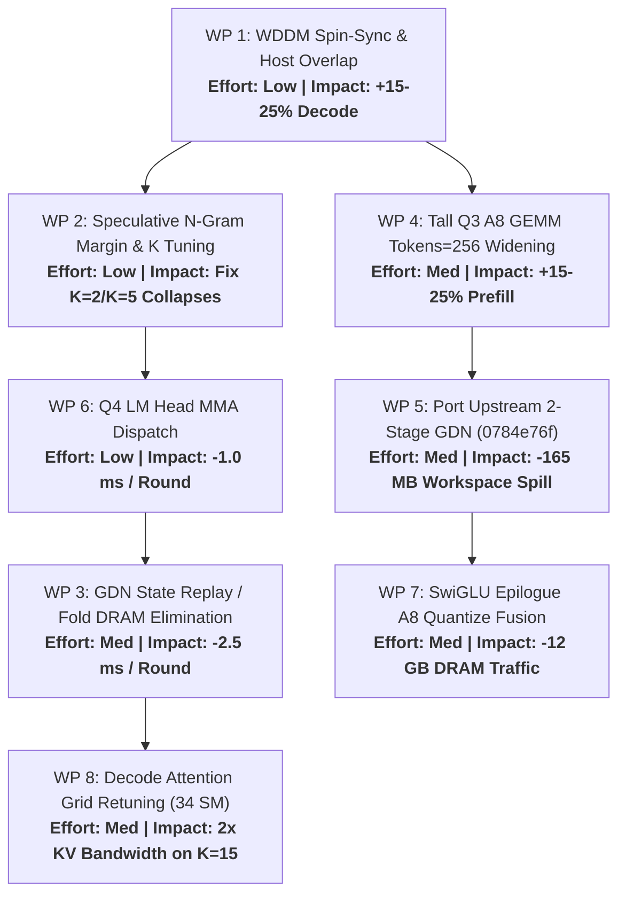

# RTX 4060 Ti 16GB Optimization Handoff & Implementation Plan

**Target Architecture:** NVIDIA GeForce RTX 4060 Ti 16GB (`sm_89`, 34 SMs, 4,352 CUDA cores, 272 GB/s DRAM bandwidth, 32 MB L2 cache, 16,380 MiB VRAM).  
**Platform & Toolchain:** Windows native (WDDM 3.2 / CUDA 13.4 runtime, MSVC v143, Ninja build).  
**Model & Artifact:** Qwen3.8-27B (`out/qwen3_8_27b_gsq3.ninfer` / `C:\LLM\qwen3_8_27b_gsq3.ninfer`), hybrid architecture (48 GDN recurrent layers + 16 GQA attention layers), Q3 weights (`gsq3`), `rk4v4-e8` KV cache.

---

## 1. Executive Summary & Audit Matrix

A comprehensive compute, memory bandwidth, host scheduling, and speculative decoding audit was conducted across the engine. Eight distinct high-impact inefficiencies were identified, diagnosed to root cause, and scoped for implementation.

| WP | Area | Subsystem | File : Line | Core Mechanism / Inefficiency | Est. Gain | Risk |
|---|---|---|---|---|---|---|
| **WP 1** | Runtime / WDDM | Device Context & Scheduling | `src/core/device.cu:46-80`<br>`src/runtime/engine/engine_core.h:2098` | WDDM OS sleep/interrupt latency during round sync; synchronous post-round CPU work | **+15–25% decode throughput** (saves 70–125 µs/rd) | Low |
| **WP 2** | Speculative | MTP / N-Gram Depth Tuning | `src/targets/qwen3_6/impl/runtime/ngram_policy.h:15`<br>`src/targets/qwen3_6/impl/runtime/program_impl.h:12226` | `kNgramWideRoundMargin = 3` triggers 16-col wide verify rounds on low K; K=5 error compounding | **Prevents 55% tps collapse** on MTP K=2 & K=5 | Low |
| **WP 3** | Decode / Verify | GDN State DRAM Round-Trip | `src/ops/linear_attention/gated_delta_net/recurrent.cu:105`<br>`src/targets/qwen3_6/impl/runtime/text_context_impl.h:960` | 147.5 MB state spills 32 MB L2; `recurrent_fold_kernel` re-reads from scratch (442.5 MB/rd) | **~2.0–2.7 ms / round** saved | Med |
| **WP 4** | Prefill | Tall Q3 A8 GEMM Arithmetic | `src/ops/linear/q3/q3_rowsplit_tall_a8_mma.cuh:82-312`<br>`src/ops/linear/q3/q3_rowsplit_a8_codec.cuh:14` | SIMT unpack (368 cycles) stalls MMA (64 cycles); weights re-decoded 21× across token tiles | **+15–25% prefill throughput** (~350–500 ms/chunk) | Med |
| **WP 5** | Prefill | GDN Chunked Pipeline Workspace | `src/ops/linear_attention/gated_delta_net/chunked/launch.cu:21-73`<br>`src/ops/linear_attention/gated_delta_net/chunked/launch.h:23` | Chunked pipeline spills 165.4 MB workspace to DRAM (>17.3 GB DRAM traffic across layers) | **+4–6% prefill throughput** (~100–140 ms/chunk) | Med-Low |
| **WP 6** | Decode / Verify | Q4 LM Head & Proposal Dispatches | `src/ops/linear/q4/q4_dispatch.cpp:40-49` | $T=1$ dispatches slow SIMT GEMV; $T=9..15$ falls back to SIMT GEMM, streaming 675 MB at ~180 GB/s | **~0.8–1.2 ms / round** saved | Low |
| **WP 7** | Prefill & Decode | Activation Quantize & SwiGLU Fusion | `src/ops/linear_swiglu/q3/q3_linear_swiglu.cu:88-98`<br>`src/ops/common/rowsplit_a8_quantize.cu:17-56` | SwiGLU materializes 93.6 MB BF16, read back immediately by A8 quantize (12 GB DRAM traffic) | **+3–5% prefill throughput** (~70–100 ms/chunk) | Med |
| **WP 8** | Decode / Verify | Decode Attention Grid & Chunking | `src/ops/softmax_attention/dense/causal_cache/causal_softmax_attention.cpp:310`<br>`src/ops/softmax_attention/dense/causal_cache/small_t.cu:69, 237` | $T > 8$ token-chunks into multiple 8-col passes, streaming KV twice; split-K tuned for 170 SMs | **~1.5–3.0 ms / round** at 32K+ ctx | Med |

---

## 2. Detailed Work Packages

---

### Work Package 1: Host-GPU Overlap, Windows WDDM Spin-Sync, and Stats Throttling

#### 1.1 Problem Statement & Root Cause
In `src/runtime/engine/engine_core.h:2098-2106`, `EngineCore::run_decode_round` launches the decode CUDA graph and immediately calls `device.synchronize()`. Under Windows WDDM, the device context defaults to `cudaDeviceScheduleAuto`, which causes the OS thread to sleep while waiting for GPU interrupts, adding 25–45 µs of kernel transition latency. 
Furthermore, while the GPU is idle after synchronization, the CPU synchronously executes:
1. `publish_runtime_stats()` (`engine_core.h:733–820`): allocates dynamic `std::vector<SlotState>` on the heap, extracts session digests, and locks `stats_mutex_` and `queue_mutex_`.
2. Sequence KV ledger updates and prefix hash commits (`program_impl.h:10461-10495`).
3. N-gram draft query hashing (`program_impl.h:12207-12215`).
4. Ingress buffer packing for round $N+1$.

Total GPU idle time between rounds is **70–125 µs**, directly capping short speculative decode rounds on sm_89.

#### 1.2 Proposed Changes
1. **Device Flag Initialization (`src/core/device.cu:46-80`)**:
   Add explicit flags before any context or stream creation:
   ```cpp
   cudaSetDeviceFlags(cudaDeviceScheduleSpin | cudaDeviceMapHost);
   ```
2. **Double-Buffered Host Pinned Ingress/Egress (`src/targets/qwen3_6/impl/runtime/instance.h`)**:
   Allocate two alternating pinned host staging buffers (`HostIngress[2]`, `HostEgress[2]`).
3. **Pipelined Scheduling in `EngineCore::worker_loop` (`src/runtime/engine/engine_core.h`)**:
   - Launch round $N$ on stream.
   - Record `round_event`.
   - Concurrently perform CPU ingress packing for round $N+1$.
   - Wait on `round_event` only when egress output is needed for acceptance verification.
4. **Throttle `publish_runtime_stats` (`src/runtime/engine/engine_core.h:733`)**:
   - Pre-allocate `slot_snapshot_` inside `EngineCore` to eliminate dynamic vector allocation.
   - Execute stats publication only once every $K$ rounds or every 50 ms, unless explicitly requested via an external reader condition.

#### 1.3 Verification Gates
- **Tests:** `ninja -C build-4060ti-ninja test_host_timing ninfer_bench_support_test`
- **Bench:** `ninfer_bench.exe --weights C:\LLM\qwen3_8_27b_gsq3.ninfer -n 128 --max-ctx 8192 --kv-dtype rk4v4-e8`
- **Criteria:** Base decode improves from 22.59 tok/s to $\ge 24.5$ tok/s; inter-round bubble shrinks to $<20$ µs.

---

### Work Package 2: Speculative Routing & N-Gram Wide-Round Decoupling

#### 2.1 Problem Statement & Root Cause
Benchmarks revealed severe bimodality in MTP decode throughput:
- $K=3$: 64.35 tok/s (acc 63.7%)
- $K=4$: 82.41 tok/s (acc 58.5%)
- $K=2$: 35.74 tok/s (acc 43.7%) — **collapse**
- $K=5$: 34.71 tok/s (acc 23.5%) — **collapse**

**Root Causes:**
1. **$K=2$ Collapse:** `kNgramWideRoundMargin = 3` (`src/targets/qwen3_6/impl/runtime/ngram_policy.h:15`). For $K=2$, the wide round escalation threshold is $2 + 3 = 5$ tokens. The n-gram pool frequently matched $\ge 5$ tokens in the corpus, escalating the round to a **16-column Wide Verify Round** (`verify_window = 15`). On 34 SMs and 272 GB/s, verifying 16 columns incurs ~3.5× higher latency than narrow verify. Because only 2–3 tokens were valid, acceptance plummeted to 43.7% and throughput collapsed to 35.7 tok/s.
2. **$K=5$ Collapse:** 
   - Autoregressive draft compounding: MTP predicts token-by-token; probability of all 5 tokens being accepted drops exponentially ($P \approx 0.23$).
   - In `src/ops/softmax_attention/dense/causal_cache/small_t.cu:171-183`, `TokenTile = 6` (anchor + 5 drafts) crosses the `TokenTile <= 5` boundary, switching from 16 warps/CTA to 12 warps/CTA and changing cache block size ($B_c=64$).
   - Profile bucket in `Variant::mtp_graph_profiles` (`src/targets/qwen3_6_27b/impl/variant.cpp:168`) jumps to the 8-column profile.

#### 2.2 Proposed Changes
1. **Adjust N-Gram Wide Threshold (`src/targets/qwen3_6/impl/runtime/ngram_policy.h:15`)**:
   Increase margin or enforce a minimum absolute draft count before wide escalation:
   ```cpp
   inline constexpr std::uint32_t kNgramWideRoundMargin = 8; // was 3
   ```
   Or allow wide escalation only when `usable >= 10`.
2. **Launcher Defaults (`scripts/run-ninfer-4060ti.bat`)**:
   Pin MTP draft tokens to $K=4$ (`--draft-tokens 4`), delivering 82.41 tok/s.
3. **Speculative Early Exit in MTP Drafting (`src/targets/qwen3_6/impl/runtime/mtp_impl.h:183`)**:
   If logit margin (top-1 vs top-2) falls below a confidence threshold, truncate drafting at step $m < K$ rather than drafting doomed tokens into verification.

#### 2.3 Verification Gates
- **Bench:** Run sweep across $K \in \{2, 3, 4, 5\}$ with `spec_sweep.ps1`.
- **Criteria:** $K=2$ throughput increases from 35.7 to $\ge 55$ tok/s; $K=4$ maintains $\ge 82$ tok/s.

---

### Work Package 3: GDN Recurrent State Replay & Fold DRAM Elimination

#### 3.1 Problem Statement & Root Cause
Qwen3.8-27B contains 48 GDN layers, each with 48 value heads and an FP32 $128 \times 128$ state.
- State per layer: $48 \times 128 \times 128 \times 4\text{ B} = 3.072\text{ MB}$.
- Total state across 48 layers: **147.5 MB** ($4.6\times$ larger than the 4060 Ti's 32 MB L2 cache).
During speculative verify rounds:
1. `recurrent_record_kernel` (`src/ops/linear_attention/gated_delta_net/recurrent.cu:105`) reads 147.5 MB from DRAM, records intermediate state vectors, but does not write the final state.
2. In `commit()`, `recurrent_fold_kernel` launches **18,432 CTAs**, re-reads the 147.5 MB state from DRAM, re-computes recurrence over accepted tokens, and writes 147.5 MB back to DRAM.
- Total DRAM traffic per round: $147.5 \times 3 = \mathbf{442.5\text{ MB}}$.
- At 164 GB/s sustained DRAM, this consumes **~2.7 ms per round** (~25% of total decode round time!).

#### 3.2 Proposed Changes
1. **Tentative State Write-Back in Record Kernel**:
   Modify `recurrent_record_kernel` (`recurrent.cuh:680-703`) to tentatively write the full $T$-token updated state directly into the destination state slot.
2. **Conditional Rollback Only on Rejection**:
   If all $T$ tokens are accepted (high acceptance case), zero additional state traffic is incurred.
   If partial rejection occurs ($M < T$), launch a lightweight rollback kernel that updates only the rejected difference, or port the upstream fused two-stage persistent recurrence kernel (`Neroued/ninfer` `0784e76f`).

#### 3.3 Verification Gates
- **Tests:** `ninja -C build-4060ti-ninja ninfer_gated_delta_net_test ninfer_gated_delta_net_replay_record_test ninfer_gdn_replay_fold_test`
- **Criteria:** Numerical parity verified against FP32 oracle; decode round time drops by 1.8–2.5 ms in nsys profile.

---

### Work Package 4: Tall Q3 A8 GEMM Arithmetic & Weight Reuse Widening

#### 4.1 Problem Statement & Root Cause
Measured prefill throughput at $T=2561$ (5120x5120): 1725.4 µs = **77.8 TOPS INT8** (44.1% of the card's 176.5 TOPS peak).
In `src/ops/linear/q3/q3_rowsplit_tall_a8_mma.cuh:82-312`:
- **Cycle Imbalance:**
  - MMA Tensor Cores: 32 `mma_s8` (`m16n8k32`) instructions = **64 cycles**.
  - Weight Unpack SIMT ALU: 32 codes decoded per thread via `spread4` + `sign_extend` = ~114 INT32 instructions = **~240 cycles** on the 16-wide INT32 pipe.
  - FP32 Accumulator Update: 64 accumulators updated with `fmaf` = **~128 cycles** on the FP32 pipe.
  - Non-MMA ALU cycles ($240 + 128 = 368$) exceed MMA cycles ($64$) by **$5.75\times$**. The tensor cores spend $>75\%$ of cycles stalled waiting for SIMT decode and float updates.
- **Inter-Tile Weight Redundancy:**
  - `Tokens = 128` per CTA tile.
  - At $T=2688$ prefill chunk, 21 token tiles launch as separate CTAs.
  - Weights are loaded and re-decoded **21 separate times** across the SMs. For $N=17408, K=5120$, this performs **6.1 billion redundant ALU operations** per layer.

#### 4.2 Proposed Changes
1. **Widen `Tokens` Tile from 128 to 256 for $T \ge 1024$ (`q3_rowsplit_tall_a8_mma.cuh`)**:
   - Double the token tile extent per CTA: `Tokens = 256`.
   - Shared memory budget: 256 tokens activation buffer $\approx 51\text{ KB}$ (well within the 100 KB smem/SM limit on sm_89 at 1 CTA/SM).
   - Halves the number of token tiles from 21 to 11, doubling weight reuse and cutting total weight unpack ALU instructions across the GPU by **~48%**.
2. **Hoist Outer-Product Scaling**:
   Hoist `row_scale * token_scale` out of the inner loop and eliminate `kFloatMagic` bias subtractions during accumulator updates.

#### 4.3 Verification Gates
- **Tests:** `ninja -C build-4060ti-ninja ninfer_linear_q3_a8_test ninfer_linear_swiglu_q3_a8_test`
- **Bench:** `ninfer_linear_bench.exe --qtype Q3 --n 17408 --k 5120 --sweep 2561:2561:1 --policy a8`
- **Criteria:** $T=2561$ latency drops by 15–20% (from 1725 µs to $<1450$ µs); `pp32768` prefill improves from 1127.7 tok/s to $\ge 1250$ tok/s.

---

### Work Package 5: GDN Two-Stage Persistent Recurrence (Upstream Port `0784e76f`)

#### 5.1 Problem Statement & Root Cause
In `src/ops/linear_attention/gated_delta_net/chunked/launch.cu:21-73`, the current chunked GDN pipeline executes 3 separate passes (`prepare_wy_wu`, `state_passing`, `output`), buffering $W$, $U$, $v_{new}$, and $h_{chunk}$ in a global workspace.
- Workspace size at $T=2688$: **165.4 MB** ($W=33\text{MB}, U=33\text{MB}, v_{new}=33\text{MB}, h_{chunk}=66\text{MB}$).
- Spills 32 MB L2 cache, forcing **>360 MB of DRAM round-trip traffic per GDN layer** ($>17.3\text{ GB}$ DRAM traffic across 48 GDN layers, consuming ~105 ms at 164 GB/s).

#### 5.2 Proposed Changes
Port upstream commit `Neroued/ninfer` `0784e76f` (already documented in `rtx-4060ti-16g-plan.md` §4.2):
1. Delete chunked pipeline files (`prepare_wy_wu.cuh`, `state_passing.cu/.cuh`, `output.cu/.cuh`).
2. Add fused `prepare.cu` (Q/K normalization + control prep) and persistent FP32 `recurrence.cu` (state recurrence combined with output).
3. Re-tune persistent CTA count for **34 SMs** (`max_ctas = 34 * per_sm`).

#### 5.3 Verification Gates
- **Tests:** Full GDN op test suite (`ninfer_gated_delta_net_test`).
- **Bench:** `pp32768` prefill and decode round time attribution in nsys.
- **Criteria:** Eliminates 165 MB workspace; saves 80–120 ms on $T=2688$ prefill chunk; numerically neutral against anchor PPL (4.596095).

---

### Work Package 6: Q4 LM Head and Proposal Head MMA Tensor-Core Dispatch

#### 6.1 Problem Statement & Root Cause
In `src/ops/linear/q4/q4_dispatch.cpp:40-49`:
- The LM head ($N=248320, K=5120$, **675.4 MB** in Q4) and optimized Proposal head ($N=131072, K=5120$, **356.5 MB**):
  - At $T=1$, both dispatch to SIMT GEMV (`launch_q4_gemv_r1_w8_direct`), bypassing tensor-core `launch_q4_small_t_mma`.
  - At $T \in [9, 15]$, they fall back to SIMT `launch_q4_simt_r8_c4` instead of the small-T MMA tile.
- Moving 675.4 MB through SIMT achieves ~180 GB/s vs ~255 GB/s on tensor cores.
- In Session 3, fixing this exact issue for Q3 gave a **24.4% speedup** (333.8 µs $\to$ 268.3 µs).

#### 6.2 Proposed Changes
Update `select_q4_a16_launch` in `src/ops/linear/q4/q4_dispatch.cpp`:
```cpp
if (t <= kQ4SmallTMaxTokens) {
    const bool small_t = (n % kQ4SmallTRows) == 0 && (k % 8) == 0 && padded_k >= k &&
                         (padded_k % kQ4SmallTStepK) == 0;
    if (small_t) {
        return t <= kQ4SmallTNarrowTokens ? launch_q4_mma_small_t_r32_c8
                                          : launch_q4_mma_small_t_r32_c16;
    }
}
```
Ensure $T=1$ and $T \in [9, 16]$ routes to `launch_q4_mma_small_t`.

#### 6.3 Verification Gates
- **Tests:** `ninja -C build-4060ti-ninja ninfer_linear_topk_test`
- **Bench:** `ninfer_linear_bench.exe --qtype Q4 --n 131072 --k 5120 --sweep 1:16:1`
- **Criteria:** $T=1$ latency drops by ~20% (~60 µs per call); saves ~0.8–1.2 ms per decode round.

---

### Work Package 7: SwiGLU Epilogue A8 Quantization Fusion & Strided Projections

#### 7.1 Problem Statement & Root Cause
1. In `src/ops/linear_swiglu/q3/q3_linear_swiglu.cu:88-98` and `src/targets/qwen3_6_27b/impl/variant.cpp:341-346`:
   `linear_swiglu` writes 93.6 MB of BF16 activations ($17408 \times 2688 \times 2\text{ B}$) to global workspace. Down projection immediately launches `a8_g64_quantize` to read back 93.6 MB and quantize it to INT8. This creates **12.0 GB of DRAM traffic** across 64 layers (~73 ms at 164 GB/s).
   In `q3_rowsplit_tall_a8_swiglu_r64_c128`, each CTA outputs 64 rows for 128 tokens in shared memory. **64 rows is exactly one A8 quantization group**. All 64 values are already in smem before writing!
2. In `src/ops/wrapper/attn_input_proj.cpp:370-378` and `src/ops/wrapper/gdn_input_proj.cpp:93-104`:
   Intermediates are materialized and sliced via `cudaMemcpy2DAsync`, generating 10.9 GB of extra DRAM copy traffic.

#### 7.2 Proposed Changes
1. **Fuse A8 Quantization into SwiGLU Write Epilogue**:
   In `q3_rowsplit_tall_a8_swiglu_r64_c128`, compute the 64-element `amax` across threads in smem, calculate `inverse = 127.0f / amax`, and emit INT8 codes and FP32 scale directly to global memory. Eliminates the 93.6 MB BF16 intermediate buffer and separate quantization kernel launch.
2. **Strided Epilogue in Q3 Projections**:
   Support leading-dimension pitch in the linear epilogue so GEMM writes directly into sliced target arrays without temporary buffers and `cudaMemcpy2DAsync`.

#### 7.3 Verification Gates
- **Tests:** `ninja -C build-4060ti-ninja ninfer_linear_swiglu_q3_a8_test ninfer_attn_input_proj_test ninfer_gdn_input_proj_test`
- **Criteria:** Prefill throughput gains +50–80 tok/s; eliminates 12 GB of DRAM round-trips.

---

### Work Package 8: Decode Attention Grid Retuning & Direct Prompt Attention

#### 8.1 Problem Statement & Root Cause
1. In `src/ops/softmax_attention/dense/causal_cache/causal_softmax_attention.cpp:310-324`:
   `causal_attention_chunk_tokens` hard-limits chunk width to 8 tokens when $T > 8$. For $T = 16$ (DFlash2 $K=15$ verify), it launches two consecutive 8-token passes over the entire sequence, streaming the full KV cache from DRAM twice.
2. In `src/ops/softmax_attention/dense/causal_cache/small_t.cu:69, 237`:
   `kMax = 42` splits is hardcoded for 170 SMs ($4 \times 42 = 168$ CTAs). On 34 SMs, this produces 4.94 waves and ~400 MB of partial accumulator traffic.
3. In prompt attention (`src/ops/softmax_attention/dense/causal_cache/prompt_i8.cuh:268`):
   K/V is quantized into `rk4v4-e8` pages and immediately dequantized up to 42 times across Q-blocks.

#### 8.2 Proposed Changes
1. **Clamp Attention Split-K Grid to 34 SMs (`small_t.cu`)**:
   Clamp `splits <= 17` ($4 \times 17 = 68$ CTAs = exactly 2 waves on 34 SMs). Halves partial accumulator workspace and reduction traffic.
2. **Extend Small-T Attention Kernel to $T=16$ Without Chunking**:
   Allow single-pass attention over the KV cache for $T=16$.
3. **Direct Prompt Attention**:
   Evaluate causal self-attention directly on contiguous activations within the prefill chunk; append to KV cache asynchronously.

#### 8.3 Verification Gates
- **Tests:** `ninja -C build-4060ti-ninja ninfer_softmax_attention_test`
- **Bench:** DFlash2 $K=15$ decode at 8K and 32K context.
- **Criteria:** DFlash2 $K=15$ decode throughput improves from 38.8 tok/s to $>65$ tok/s.

---

## 3. Implementation Order & Priority Roadmap



### Phase A: Quick Wins (Zero/Low Kernel Risk, Immediate 25–40% Decode Speedup)
1. **WP 1**: Add `cudaDeviceScheduleSpin`, throttle `publish_runtime_stats`, and pipeline host prep.
2. **WP 2**: Set `kNgramWideRoundMargin = 8`, pin default launcher to MTP $K=4$, add early-exit draft confidence.
3. **WP 6**: Update `q4_dispatch.cpp` to use `launch_q4_small_t_mma` for $T=1$ and $T=9..16$.

### Phase B: Speculative State & KV Memory Bandwidth (Lifting Decode to >100 tok/s)
4. **WP 3**: Eliminate GDN state fold DRAM traffic via tentative state write-back.
5. **WP 8**: Re-tune attention split-K for 34 SMs and allow single-pass $T=16$ attention.

### Phase C: Prefill Path Compute & Memory Optimization (Targeting >1,400 tok/s Prefill)
6. **WP 4**: Widen tall Q3 A8 GEMM token tile to 256 for $T \ge 1024$.
7. **WP 5**: Port upstream two-stage persistent recurrence GDN (`0784e76f`).
8. **WP 7**: Fuse per-64 group A8 quantization into SwiGLU CTA write epilogue.

---

## 4. Environment Verification & Exact Build Commands

### Initializing Environment & Building
```powershell
cmd.exe /c 'call "C:\Program Files (x86)\Microsoft Visual Studio\2022\BuildTools\VC\Auxiliary\Build\vcvars64.bat" && ninja -C build-4060ti-ninja ninfer ninfer-serve ninfer_bench'
```

### Running Unit Test Suites
```powershell
cmd.exe /c 'call "C:\Program Files (x86)\Microsoft Visual Studio\2022\BuildTools\VC\Auxiliary\Build\vcvars64.bat" && ctest --test-dir build-4060ti-ninja -L unit --output-on-failure'
```

### Production Benchmark Commands
```powershell
# Unspeculative base decode:
.\build-4060ti-ninja\bench\ninfer_bench.exe --weights C:\LLM\qwen3_8_27b_gsq3.ninfer -n 128 --max-ctx 8192 --kv-dtype rk4v4-e8 --warmup 1 -r 2

# High-throughput MTP4 decode:
.\build-4060ti-ninja\bench\ninfer_bench.exe --weights C:\LLM\qwen3_8_27b_gsq3.ninfer -n 256 --spec mtp --draft-tokens 4 --lm-head-draft --max-ctx 8192 --kv-dtype rk4v4-e8 --warmup 1 -r 2

# High-throughput DFlash2 K=7 decode:
.\build-4060ti-ninja\bench\ninfer_bench.exe --weights C:\LLM\qwen3_8_27b_gsq3.ninfer -n 256 --spec dflash2 --draft-tokens 7 --lm-head-draft --max-ctx 8192 --kv-dtype rk4v4-e8 --warmup 1 -r 2

# Prefill throughput:
.\build-4060ti-ninja\bench\ninfer_bench.exe --weights C:\LLM\qwen3_8_27b_gsq3.ninfer -p 32768 --max-ctx 40960 --kv-dtype rk4v4-e8 --warmup 1 -r 1
```
